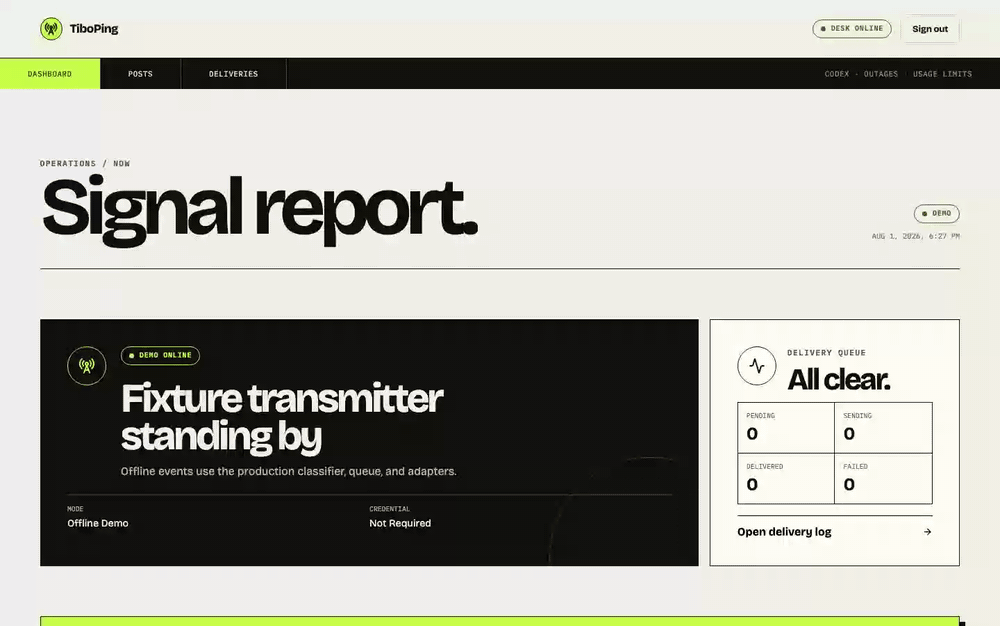

# TiboPing

**Never miss a Tibo post that matters.** TiboPing watches
[@thsottiaux](https://x.com/thsottiaux), classifies each post, and relays it to
Slack, Discord, or any signed webhook you control.



Pick **Everything**, or subscribe each destination to any combination of:

| Signal                    | Includes                                                                |
| ------------------------- | ----------------------------------------------------------------------- |
| **Codex + releases**      | Codex news and named model shipping, rollout, sunset, or deprecation    |
| **Outages**               | Incidents, degraded service, recovery, resolution, and restoration      |
| **Usage limits + resets** | Usage/rate limits, quotas, allowances, credits, resets, and big buttons |

Multi-category posts are delivered once per destination. “Everything” also includes
unmatched posts, replies, and quotes; reposts are ignored.

> [!IMPORTANT]
> Live monitoring uses the official X API, which is currently credit-based and
> pay-per-use. TiboPing does not scrape X. You can run the complete product in offline
> demo mode without an X account, token, credits, or paid network call. Review X’s
> [current pricing](https://docs.x.com/x-api/getting-started/pricing) before going live.

## Why TiboPing

- **One container.** The dashboard, watcher, classifier, delivery queue, and SQLite
  database ship together.
- **No AI bill or mystery labels.** Versioned, deterministic rules explain every
  category match.
- **Safe first start.** Live mode checkpoints the latest post instead of replaying old
  history, then catches up after disconnects.
- **Reliable delivery.** Per-destination routing, retries, rate-limit handling,
  pause/resume, manual recovery, and local duplicate prevention are built in.
- **Self-hosted by design.** No TiboPing account, hosted control plane, telemetry, or
  third-party database.
- **A real demo.** Synthetic posts travel through the same classifier, SQLite queue,
  retry worker, and adapters as live posts.

## Three-step demo

### 1. Create local configuration

```bash
cp .env.example .env
openssl rand -base64 32
```

Put the generated value in `APP_SECRET`, choose an `ADMIN_PASSWORD` of at least 12
characters, and set `DEMO_MODE=true` in `.env`.

### 2. Start TiboPing

```bash
docker compose up --build -d
```

### 3. Open the signal desk

Visit [http://localhost:3000](http://localhost:3000), enter your admin password, and
follow the five-step setup. For a local generic webhook, set
`ALLOW_PRIVATE_WEBHOOKS=true`; leave it false for normal internet-facing destinations.

The dashboard’s demo transmitter can now emit Codex, outage, usage-limit,
multi-category, and unmatched fixtures through the complete production pipeline.

```bash
# Health and readiness
curl --fail http://localhost:3000/healthz
curl --fail http://localhost:3000/readyz

# Follow logs
docker compose logs -f tiboping

# Stop without deleting SQLite data
docker compose down
```

## Go live with X

1. Create an App in the [X Developer Console](https://console.x.com/) and obtain its
   app-only Bearer Token. X documents the process in
   [Getting Access](https://docs.x.com/x-api/getting-started/getting-access).
2. Add credits and a spending limit in the console. TiboPing uses one
   [Filtered Stream](https://docs.x.com/x-api/posts/filtered-stream/introduction)
   connection with the rule `from:thsottiaux -is:retweet`, plus user lookup/timeline
   calls for verification and reconnect catch-up. X allows one pay-per-use stream
   connection per App, so use a dedicated App.
3. Set `DEMO_MODE=false`. Either set `X_BEARER_TOKEN` in `.env`, or leave it blank and
   enter the token in the setup screen. Restart with `docker compose up -d`.

When the token comes from the setup screen, it is encrypted in SQLite. An environment
token always takes precedence and cannot be changed from the UI.

The first activation checkpoints the newest existing post. It does **not** notify old
posts. On later reconnects, TiboPing fetches everything after its durable cursor before
resuming the live stream.

## Destinations

| Destination | What you provide              | Delivery format                        |
| ----------- | ----------------------------- | -------------------------------------- |
| Slack       | Official incoming webhook URL | Blocks with category line and X button |
| Discord     | Official channel webhook URL  | Embed with categories and timestamp    |
| Generic     | HTTPS endpoint                | Versioned JSON + HMAC-SHA256 signature |

Each destination can use Everything or any subset of the three signal categories.
Webhook URLs and signing secrets are encrypted at rest. See
[Add a destination](docs/add-a-destination.md) and the
[generic webhook contract](docs/generic-webhook.md).

Native WhatsApp delivery is not in v0.1. A generic webhook can bridge TiboPing into
WhatsApp, Teams, Telegram, ntfy, Home Assistant, or an automation platform today.

## Operations

### Back up SQLite

Stop writes, copy the database out of the named volume, and restart:

```bash
docker compose stop tiboping
docker compose cp tiboping:/data/tiboping.sqlite ./tiboping.sqlite.backup
docker compose start tiboping
```

Keep the matching `APP_SECRET` with every backup. Without it, encrypted X credentials
and destination configurations cannot be recovered.

### Upgrade

Back up first, then rebuild from the new revision. Database migrations run
automatically at startup.

```bash
git pull --ff-only
docker compose build --pull
docker compose up -d
docker compose ps
```

### Put it behind HTTPS

The Compose file binds to `127.0.0.1` by default. Keep that binding and proxy a root
domain through Caddy, nginx, or Traefik. Set `PUBLIC_URL` to the exact external origin,
for example `https://tiboping.example.com`; it controls secure cookies and CSRF origin
checks. Do not publish the dashboard on a different origin without updating it.

### Rotate secrets

- Rotate a generic webhook’s signing secret from **Dashboard → Secret**, update the
  receiver, then send a test notification.
- Rotate Slack/Discord webhooks at the provider, then update and test the destination.
- Rotate an environment-managed X token in `.env` and restart.
- Treat `APP_SECRET` as the database root key. v0.1 has no online root-key rotation;
  changing it makes existing encrypted configuration unreadable.
- Changing `ADMIN_PASSWORD` affects new logins after restart. Existing signed sessions
  expire within eight hours.

## Troubleshooting

| Symptom                             | Check                                                                 |
| ----------------------------------- | --------------------------------------------------------------------- |
| X verification fails                | Token, credit balance, filtered-stream access, and another connection |
| Source says `degraded`              | X/API connectivity; TiboPing reconnects with exponential backoff      |
| Login works but actions return 403  | `PUBLIC_URL` must exactly match the browser’s origin                  |
| Webhook is rejected during setup    | HTTPS, official provider URL shape, and public DNS resolution         |
| LAN webhook is rejected             | Explicitly set `ALLOW_PRIVATE_WEBHOOKS=true` and understand SSRF risk |
| Destination pauses after a delivery | Repair its endpoint, Resume it, then Retry the failed delivery        |

Duplicate prevention is local to one SQLite database. If two independent TiboPing
installations point at the same channel, both can deliver the same post. Run one active
installation per destination, or deduplicate generic events by `event_id` downstream.

## Development

Requires Node.js 24+ and npm 11+.

```bash
npm ci
npm run dev
npm test
npm run lint
npm run typecheck
npm run test:e2e
```

Useful reading:

- [Architecture](docs/architecture.md)
- [Classification rules](docs/classification-rules.md)
- [Adding and testing destinations](docs/add-a-destination.md)
- [Signed generic webhook v1](docs/generic-webhook.md)
- [Contributing](CONTRIBUTING.md)
- [Security policy](SECURITY.md)

## Roadmap

- Native WhatsApp and additional adapters
- User-defined watched accounts and classifier packs
- Import/export and supported `APP_SECRET` rotation
- Optional metrics and multi-operator authentication

If that direction sounds useful, a ⭐ helps other self-hosters find the project. Focused
issues and small adapters are especially welcome.

## Independence and license

TiboPing is an independent community project. It is not affiliated with, endorsed by,
or sponsored by OpenAI, X Corp., Slack, Discord, or Tibo. “OpenAI,” “Codex,” “X,”
“Slack,” and “Discord” are trademarks of their respective owners and are used only to
describe interoperability.

Released under the [MIT License](LICENSE).
