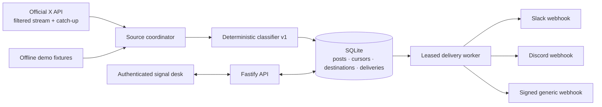

# Architecture

TiboPing v0.1 is a single Node.js process with one SQLite database. The production
container serves the React dashboard, holds the X stream, classifies posts, and drains
the delivery queue. There is no external broker, cache, database, or control plane.

## Packages

- `packages/core` owns public schemas, normalized post types, classifier rules,
  fixtures, routing categories, and the generic webhook envelope.
- `apps/server` owns configuration, encryption, SQLite repositories, X connectivity,
  routing, adapters, retries, authentication, APIs, and production asset serving.
- `apps/web` owns the login, setup wizard, dashboard, post ledger, and delivery log.

## Source lifecycle

The live source is fixed to public account `@thsottiaux` in v0.1.

1. Verification resolves the username, confirms the account is public, installs the
   tagged rule `from:thsottiaux -is:retweet`, fetches recent posts, and proves the
   filtered stream can open.
2. On first activation, the source coordinator stores the newest visible post ID as its
   cursor without routing historical posts.
3. On a normal connection, it opens the live stream first, fetches timeline posts after
   the durable cursor, processes catch-up oldest-first, drains anything buffered from
   the stream, then switches to live delivery.
4. Cursor advancement, post insertion, classification metadata, and delivery creation
   happen in SQLite transactions. Post IDs and `(post_id, destination_id)` are unique.
5. Disconnects use exponential reconnect delays capped at 60 seconds. Catch-up closes
   the gap after each reconnect.

The stream excludes reposts. Replies and quote posts authored by Tibo are normalized and
can be delivered. Long-form Note Tweet text is preferred when X provides it.

## Classification and routing

Classification is a pure function: normalized text in, a classifier version, zero or
more categories, and matched rule IDs out. It performs no inference and no network
access. See [classification-rules.md](classification-rules.md).

For every newly inserted post, the router considers active destinations:

- `everything` creates one delivery regardless of the classifier result;
- `categories` creates one delivery when any selected category intersects the post’s
  categories;
- a multi-category match still creates only one delivery for that destination;
- paused and deleted destinations receive no new deliveries.

## Delivery state machine

Deliveries move through `pending → sending → delivered`, or return to `pending` for a
scheduled retry. Workers claim rows with a 30-second lease so a process failure does not
strand `sending` work forever.

Network failures, HTTP 408, 429, and 5xx responses retry after 30 seconds, 2 minutes, 10
minutes, 30 minutes, 2 hours, and 6 hours. A provider `Retry-After` value can only extend
that delay. After the retry budget is exhausted, the row fails permanently.

Redirects and other permanent endpoint failures fail the row and pause only that
destination. Other destinations continue independently. The operator can repair and
resume the endpoint, then retry a failed row from the dashboard.

## Storage and secret handling

`APP_SECRET` must be the base64 encoding of 32 random bytes. HKDF-SHA256 derives
independent database-encryption and session-signing keys from it.

Destination configurations and an X token entered through setup are stored as
context-bound AES-256-GCM envelopes. The application redactor removes secret-like
fields, registered credentials, and known Slack/Discord webhook URL shapes from logs.
The API returns masked configuration state, not stored credentials.

SQLite uses WAL mode and foreign keys. Schema migrations run before the HTTP listener,
worker, or source starts. The named `/data` volume is the only persistent container
state.

## Dashboard security

TiboPing has one operator, not user accounts. Login compares a keyed password verifier
in constant time and is limited to five attempts per minute. A successful login creates
an eight-hour, signed, HttpOnly, SameSite=Strict cookie. State-changing API calls also
require the matching origin and an in-memory CSRF token.

`PUBLIC_URL` defines the accepted origin and whether the cookie is Secure. Production
deployments reachable over a network should use an HTTPS reverse proxy and an exact
HTTPS `PUBLIC_URL`.

Outbound destination URLs reject credentials, redirects, non-HTTPS schemes, and DNS
answers in private or non-routable ranges. Slack and Discord additionally require their
official webhook host/path shapes. `ALLOW_PRIVATE_WEBHOOKS=true` relaxes the scheme and
network-range policy only for generic webhooks.

## Runtime and shutdown

Startup order is HTTP, delivery worker, then source. Shutdown reverses that order, waits
for each unit, closes Fastify, and finally closes SQLite. The container runs as the
unprivileged `node` user with a read-only root filesystem; only `/data` is writable.

`GET /healthz` proves the process can answer. `GET /readyz` proves database migrations
completed. Both endpoints are intentionally unauthenticated for container orchestration.

## Known topology boundary

Uniqueness and cursor state belong to one SQLite database. Two independent TiboPing
instances cannot coordinate and may deliver the same X post twice to a shared channel.
Use a single active instance per destination, or make a generic receiver idempotent by
`event_id`.
