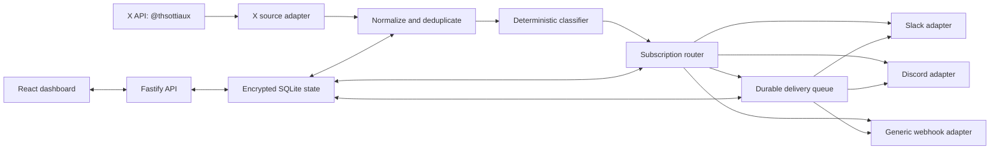

# TiboPing v0.1 Design

**Status:** Approved for implementation  
**Date:** 2026-08-01  
**License:** MIT  
**Target account:** [Thibault “Tibo” Sottiaux (`@thsottiaux`)](https://x.com/thsottiaux)

## Summary

TiboPing is a small, self-hosted, open-source service that watches Tibo's public X posts and sends selected updates to community channels. Version 0.1 supports Slack incoming webhooks, Discord incoming webhooks, and a generic signed webhook. An administrator may route every authored post or subscribe each destination to any combination of three categories:

- **Codex:** Codex features, models, releases, deprecations, and product updates.
- **Outages:** Incidents, downtime, degraded behavior, fixes, and recovery.
- **Usage limits:** Limits, quotas, credits, rate limits, resets, and reset euphemisms such as the “big button.”

“Everything” is a routing mode, not a fourth category. It receives every authored post, including posts that match no category. Category subscriptions receive only matching posts. One post may match multiple categories, but a destination receives only one delivery job for that post.

The project is deliberately narrow and playful, but its internal adapter boundaries make additional destinations possible without redesigning the pipeline.

## Goals

1. Notify configured destinations within seconds of a new public post from `@thsottiaux` under normal operating conditions.
2. Let an operator choose Everything or one or more of Codex, Outages, and Usage limits independently for every destination.
3. Make a fresh instance understandable and runnable with Docker Compose, a short `.env` file, and a browser-based setup wizard.
4. Survive restarts and temporary source or destination failures without losing the durable cursor or creating duplicate delivery jobs.
5. Keep X credentials, webhook URLs, and signing secrets encrypted at rest and out of logs.
6. Make classifiers and destination adapters small, documented, and straightforward for contributors to extend.
7. Ship an offline demo mode so the repository can be evaluated without paid X API access.

## Non-goals for v0.1

- A hosted, multi-tenant service or public user accounts.
- WhatsApp, Telegram, email, Matrix, SMS, or mobile push. WhatsApp is the planned headline destination for v0.2.
- Watching arbitrary X accounts or multiple source accounts.
- Scraping X or depending on an unofficial frontend.
- OAuth installation flows for Slack or Discord; v0.1 uses incoming webhook URLs.
- An LLM or remote classification service.
- A public API for changing administrative configuration.
- Historical broadcast on initial setup.
- Exactly-once delivery across remote HTTP services. TiboPing prevents duplicate local jobs, but an ambiguous network failure can occur after a remote service accepted a message and before it acknowledged the request.

## Users and operating model

TiboPing has one operator per instance. The operator deploys it, signs into the local dashboard, enters the X credential, and configures destinations. Members of the connected Slack workspaces or Discord servers do not need TiboPing accounts.

The service has no telemetry and sends data only to X and the destinations explicitly configured by the operator. The dashboard is suitable for exposure behind an HTTPS reverse proxy, but the default Docker Compose setup binds it locally.

## System architecture

TiboPing is one TypeScript application and one Docker container. Fastify serves a React single-page application and the authenticated JSON API. The same process runs the X source adapter, classifier, router, and durable delivery worker. SQLite is the only stateful dependency.



### Module boundaries

The backend is divided into the following independently testable units:

- **Source adapter:** Resolves the fixed username, manages the X stream rule and connection, catches up from the durable cursor, and emits normalized source posts.
- **Post repository:** Persists normalized posts and advances the source cursor transactionally.
- **Classifier:** Accepts normalized text and returns zero or more category identifiers. It has no database, network, or clock dependency.
- **Router:** Applies each active destination's routing mode and creates at most one delivery row per post and destination.
- **Destination adapters:** Validate configuration, render the shared notification model, send it, and translate provider responses into success, retryable failure, rate limit, or permanent failure.
- **Delivery worker:** Claims due delivery rows, invokes the selected adapter, records outcomes, and schedules retries.
- **HTTP API:** Authenticates the operator and exposes setup, status, destination, post, and delivery operations.
- **Web application:** Implements the first-run wizard and operations dashboard using only the HTTP API.

No destination adapter imports another adapter. Provider-specific payloads remain inside their adapter packages. The classifier knows nothing about routing or delivery.

## Source ingestion

### X API behavior

The only production source in v0.1 is the official X API using an app bearer token. The adapter resolves `thsottiaux` to its immutable X user ID, then ensures an app-owned filtered-stream rule equivalent to:

```text
from:thsottiaux -is:retweet
```

The rule is tagged with a TiboPing-specific identifier. The app must not delete or mutate unrelated rules that happen to exist for the same X application.

Original posts, replies, and quote posts are included because operational news often appears in replies. Reposts are excluded. The normalized post contains the post ID, author ID and username, UTF-8 text, creation time, canonical X URL, referenced-post metadata needed to identify quotes or replies, and ingestion time.

### Startup and recovery

On the first successful connection, TiboPing fetches the most recent user timeline page, stores the greatest post ID as its checkpoint, and sends no historical notifications.

To close the race between timeline catch-up and a live connection, startup and reconnect follow a buffered handoff. The adapter opens the filtered stream and temporarily buffers its events, fetches all available timeline posts newer than the durable cursor, processes those catch-up posts oldest first, then drains the buffered stream events through the same deduplication path before entering live mode. First setup performs this handoff immediately after establishing the no-history checkpoint, so posts created during initialization are still observed. A crash while events are buffered is safe because the next timeline catch-up starts from the durable cursor.

The adapter reconnects with capped exponential backoff and jitter and honors X rate-limit reset information. Its credential verification confirms access to username lookup, the user timeline, stream-rule management, and the filtered stream before monitoring is activated.

The normalized post ID is the idempotency key. Post insertion, classification, monotonic cursor advancement, and delivery-job creation occur through a transaction boundary that makes a crash safe to replay. Cursor advancement stores the numerically greatest processed X post ID, never merely the most recently received event.

### Demo mode

`DEMO_MODE=true` replaces the X adapter with a deterministic fixture source. The dashboard can emit representative Codex, outage, usage-limit, multi-category, and unmatched posts. Demo events use clearly synthetic IDs and labels and exercise the real classifier, router, queue, and destination adapters.

## Classification

The classifier is deterministic and local. It consists of small category rule sets plus representative fixtures. Rules are case-insensitive and may use normalized phrases, word-boundary regular expressions, and narrowly scoped predicates. Each rule has a human-readable name so a classification result can record why it matched.

Initial concepts include:

- **Codex:** `codex`, named Codex models, release and rollout language near Codex terms, deprecation or sunset language, client and CLI updates, and Codex product features.
- **Outages:** `outage`, `incident`, `down`, `degraded`, `unavailable`, `recovering`, `resolved`, service restoration, and narrowly scoped “fixed” language.
- **Usage limits:** `usage`, `limit`, `quota`, `rate limit`, `credits`, `reset`, `allowance`, `capacity`, and known reset euphemisms such as `big button`.

Broad words such as “fixed,” “release,” or “button” must not match without relevant context. A rule change requires fixtures covering both intended matches and likely false positives.

The classifier returns all matching categories and rule identifiers. A post with no matches is stored with an empty category list and is routed only to Everything destinations. Category rule version `1` is stored with each classification so later rule changes are auditable. v0.1 does not automatically reclassify historical posts.

## Routing semantics

Each destination has exactly one routing configuration:

- `everything`: route every new normalized post.
- `categories`: route when the intersection of the post's categories and the destination's selected categories is non-empty. At least one category must be selected.

The router creates a delivery with a database uniqueness constraint on `(post_id, destination_id)`. If a post matches several selected categories, the resulting notification shows every matched category but still has one delivery row.

Deleting a destination soft-deletes its configuration and cancels its pending deliveries so historical delivery rows remain understandable. Pausing a destination stops new delivery creation and leaves existing failed deliveries visible. Resuming does not backfill posts observed while paused. The operator may manually retry an existing failed delivery after correcting the destination.

## Destination adapters

All adapters consume this internal model:

```ts
type Notification = {
  eventId: string;
  post: {
    id: string;
    authorName: "Tibo";
    authorUsername: "thsottiaux";
    text: string;
    url: string;
    createdAt: string;
    kind: "post" | "reply" | "quote";
  };
  categories: Array<"codex" | "outages" | "usage-limits">;
  observedAt: string;
};
```

### Slack

The Slack adapter accepts an incoming webhook URL, verifies it with a test notification, and sends a Block Kit message containing Tibo's name, post text, category badges, timestamp, and canonical link. Text is escaped for Slack formatting. Secrets never appear in returned API models.

### Discord

The Discord adapter accepts an incoming webhook URL and sends an embed with the same content. It disables allowed mentions so text from a post can never trigger `@everyone`, roles, or users. Provider limits are enforced before transmission.

### Generic webhook

The generic adapter sends `Content-Type: application/json` with this stable envelope:

```json
{
  "schema_version": "1",
  "event_id": "x:1234567890",
  "event_type": "tibo.post",
  "post": {
    "id": "1234567890",
    "author_name": "Tibo",
    "author_username": "thsottiaux",
    "text": "Example post",
    "url": "https://x.com/thsottiaux/status/1234567890",
    "created_at": "2026-08-01T12:00:00.000Z",
    "kind": "post"
  },
  "categories": ["codex"],
  "observed_at": "2026-08-01T12:00:02.000Z"
}
```

Every generic destination has its own generated signing secret. The dashboard reveals it once when the destination is created; a lost secret must be rotated rather than revealed. The raw request body is signed as `HMAC-SHA256(secret, timestamp + "." + body)`. Requests include:

```text
X-TiboPing-Event: x:1234567890
X-TiboPing-Timestamp: 1785585602
X-TiboPing-Signature: v1=<lowercase hex digest>
```

Only HTTPS generic webhook URLs are accepted by default. An explicit development setting may permit HTTP for loopback or private-network testing.

## Delivery guarantees and errors

Delivery rows have `pending`, `sending`, `delivered`, `failed`, or `cancelled` state, an attempt count, next-attempt time, timestamps, and a redacted last error. Workers claim jobs with a short lease so a process crash returns abandoned work to the queue.

The retry schedule is 30 seconds, 2 minutes, 10 minutes, 30 minutes, 2 hours, and 6 hours. A provider `Retry-After` value replaces the next scheduled delay when it is longer. Network errors, timeouts, HTTP 408, HTTP 429, and HTTP 5xx are retryable. Invalid credentials, revoked webhooks, unsupported payloads, and other non-rate-limited HTTP 4xx responses are permanent failures.

A permanent failure pauses the affected destination after its failed delivery is recorded. Other destinations continue independently. The dashboard explains whether the operator should replace credentials, edit the endpoint, wait for a rate limit, or retry.

TiboPing provides durable at-least-once attempts and local job idempotency, not remote exactly-once delivery. Slack and Discord do not accept TiboPing's idempotency key. If their server accepts a request but the connection fails before acknowledgement, a retry can produce a duplicate. Generic webhook consumers can deduplicate using `event_id`.

## Persistence model

SQLite lives at `/data/tiboping.sqlite` in the Docker image and is stored on a named volume. Automatic forward-only migrations run before the HTTP server or workers start.

Core tables are:

- `settings`: schema version, fixed source identity, encrypted X credential reference, classifier version, and source status.
- `source_cursors`: source name, latest processed post ID, and update time.
- `posts`: normalized immutable post data, classification version, categories, matched rule IDs, and ingestion time.
- `destinations`: adapter type, display name, encrypted adapter configuration, routing mode, selected categories, active/paused state, soft-deletion time, and timestamps.
- `deliveries`: post and destination IDs, state, attempt metadata, lease data, redacted error, and delivery time; unique on `(post_id, destination_id)`.
- `migrations`: applied migration identifiers and timestamps.

The app enables WAL mode, foreign keys, and a busy timeout. API list endpoints are paginated. Old posts and deliveries are retained in v0.1; automatic retention is deferred until real usage establishes a sensible default.

## Security and privacy

`APP_SECRET` and `ADMIN_PASSWORD` are required outside demo development. `APP_SECRET` is the base64 encoding of exactly 32 cryptographically random bytes. It derives distinct encryption and session-signing keys using HKDF-SHA256.

X bearer tokens, Slack and Discord webhook URLs, generic webhook URLs, and generic signing secrets are encrypted with AES-256-GCM before SQLite storage. Every encrypted value uses a fresh nonce and authenticated context describing its table and field. API responses return only masked metadata.

The admin password is supplied through the environment. Login compares an HMAC-SHA256 verifier of the submitted value with an equivalently derived verifier of the configured value using a constant-time comparison. Successful login creates a signed, HTTP-only, same-site session cookie with a bounded lifetime. Secure cookies are required when the configured public URL uses HTTPS. Login attempts are rate limited per source address.

Logs are structured and redact authorization headers, cookies, query strings, webhook URLs, tokens, secrets, and response bodies that may echo credentials. Notification text may be logged only at debug level, which is off by default. The app collects no analytics or telemetry.

Slack and Discord URLs are validated against their documented HTTPS host patterns. Discord messages disable mentions. The generic adapter validates URL syntax, blocks embedded credentials, and applies connection and response-size limits. Because the operator controls a self-hosted instance, private-network generic destinations are allowed only when the operator enables the explicit development/private-network option.

## HTTP API and interface

All `/api/*` routes except login, logout, and health require an authenticated admin session. State-changing routes require a same-origin request and CSRF protection. The browser application never receives decrypted secrets after creation.

The API groups are:

- `auth`: login, logout, and current session.
- `setup`: setup status, X credential verification, and activation.
- `status`: source, database, queue, and destination health.
- `destinations`: list, create, edit, pause, resume, delete, and send test.
- `posts`: paginated recent posts with categories and rule explanations.
- `deliveries`: paginated history and manual retry for failed rows.
- `demo`: fixture emission, available only when demo mode is enabled.

`GET /healthz` is unauthenticated and reports process liveness without configuration or secret details. `GET /readyz` reports whether migrations completed and the database is usable.

### First-run wizard

After login, an unconfigured instance guides the operator through:

1. Enter or verify the X bearer token and confirm the resolved `@thsottiaux` profile.
2. Add a Slack, Discord, or generic webhook destination.
3. Select Everything or one or more categories.
4. Send a clearly marked test notification.
5. Activate monitoring.

If `X_BEARER_TOKEN` is supplied through the environment, the first step verifies it without copying it into SQLite. Environment-provided secrets cannot be revealed or edited in the dashboard.

### Operations dashboard

The dashboard shows source connection state, the last observed post, destinations and routing choices, recent classified posts, queue counts, and delivery outcomes. Each destination supports test, edit, pause, resume, and delete. Failed deliveries display a redacted cause and an appropriate recovery action.

The layout is responsive and keyboard accessible. Status is never conveyed by color alone. Loading, empty, success, and error states are explicit.

## Configuration and deployment

The documented production variables are:

- `APP_SECRET`: required encryption and session root secret.
- `ADMIN_PASSWORD`: required dashboard password.
- `X_BEARER_TOKEN`: optional environment-provided X token; otherwise entered through setup.
- `PUBLIC_URL`: externally visible origin used for cookie and origin validation; default `http://localhost:3000`.
- `PORT`: HTTP port, default `3000`.
- `DATABASE_PATH`: default `/data/tiboping.sqlite`.
- `LOG_LEVEL`: default `info`.
- `DEMO_MODE`: default `false`.
- `ALLOW_PRIVATE_WEBHOOKS`: default `false`.

The repository includes a multi-stage Dockerfile, Docker Compose file, `.env.example`, persistent named volume, container health check, and graceful shutdown. The default Compose port binds to `127.0.0.1`; the README documents deliberate exposure behind an HTTPS reverse proxy.

The image is built for `linux/amd64` and `linux/arm64`. Runtime and package-manager versions are pinned and dependency lockfiles are committed.

## Testing strategy

### Unit tests

- Positive and negative classifier fixtures for all three categories.
- Multi-category and unmatched posts.
- Reset euphemisms including “big button.”
- X normalization, replies, quotes, repost exclusion, and post ordering.
- Routing modes and unique-job behavior.
- Slack escaping, Discord mention suppression, and provider length limits.
- Generic payload schema and HMAC test vectors.
- Encryption round trips, nonce uniqueness, associated-data failures, masking, and log redaction.
- Retry classification and backoff calculations.

### Integration tests

- Source first-run checkpoint without historical broadcast.
- Stream disconnect followed by timeline catch-up.
- Process interruption between post insertion, routing, sending, and acknowledgement.
- SQLite migrations from every committed schema version.
- Destination isolation when one provider fails or rate limits.
- Permanent failure, pause behavior, edit, test, resume, and manual retry.
- Generic webhook signature verification against the raw body.
- Environment-supplied versus database-stored credentials.

Network tests use local fake X, Slack, Discord, and generic webhook servers. The normal test suite never requires live credentials or paid API calls.

### Browser and packaging tests

- Login and rate-limited failure behavior.
- Complete first-run wizard in demo mode.
- Add, test, filter, pause, edit, resume, and delete destination flows.
- Recent-post classification explanations and delivery recovery UI.
- Keyboard-only navigation and automated accessibility checks on core screens.
- Docker image build, health/readiness endpoints, persistent restart, and demo notification smoke test.

Continuous integration runs formatting, linting, type checking, unit tests, integration tests, browser tests, image build, and dependency/license checks.

## Repository and launch experience

The working and package name is **TiboPing** / `tiboping`. A search performed during design found no GitHub repository or npm package using the exact lowercase name.

The README leads with the one-sentence purpose, an animated or short visual demo, example Slack and Discord notifications, the three categories, and a three-step Docker Compose quick start. It clearly discloses the official X API requirement and points users without credentials to demo mode.

The repository includes:

- MIT `LICENSE`.
- `README.md`, `CONTRIBUTING.md`, security policy, and code of conduct.
- Architecture and adapter-extension documentation.
- Classification rule contribution guide with fixture requirements.
- Issue templates for classifier misses, destination adapters, and bugs.
- A disclaimer that TiboPing is an independent community project and is not affiliated with or endorsed by Thibault Sottiaux, X, or OpenAI.

Project branding must not use OpenAI or X logos as its own mark. Public post content and links are presented as source data, with clear attribution.

## Acceptance criteria

v0.1 is complete only when all of the following are demonstrated:

1. A fresh clone can create `.env`, run `docker compose up -d`, pass health checks, and persist state across a container restart.
2. Demo mode completes the browser setup flow and emits fixtures through the real router and delivery worker without X credentials.
3. A valid X bearer token resolves `@thsottiaux`, installs only TiboPing's stream rule, checkpoints without initial spam, receives new original/reply/quote posts, ignores reposts, and catches up after a simulated disconnect.
4. Everything receives matched and unmatched posts. Every possible non-empty combination of category filters routes correctly. Multi-category posts create one job per destination.
5. Slack and Discord test and post payloads render the source text, timestamp, categories, and canonical link without allowing source text to create mentions.
6. Generic webhooks receive the documented version-1 JSON and a signature that passes the published verification example.
7. Restart and replay tests prove the database never contains duplicate `(post_id, destination_id)` jobs. Documentation accurately describes the remaining remote duplicate edge case.
8. Retryable failures recover according to policy, provider rate limits are honored, and permanent failure pauses only the affected destination with an actionable dashboard error.
9. A database inspection confirms stored provider credentials are encrypted, and automated redaction tests confirm secrets do not appear in normal logs or API responses.
10. Formatting, linting, type checking, unit tests, integration tests, browser tests, accessibility checks, Docker smoke tests, and the multi-architecture image build all pass in continuous integration.
11. The README, contributor documentation, security policy, license, disclaimer, and adapter/rule extension guides are present and consistent with the shipped behavior.

## Deferred roadmap

The first post-v0.1 milestone adds WhatsApp through the official WhatsApp Cloud API. Later destinations may include Telegram, Matrix, email, ntfy, and other community-requested adapters. A hosted public instance, additional watched accounts, OAuth installations, and a general event-source plugin system require separate designs rather than expanding v0.1 implicitly.
